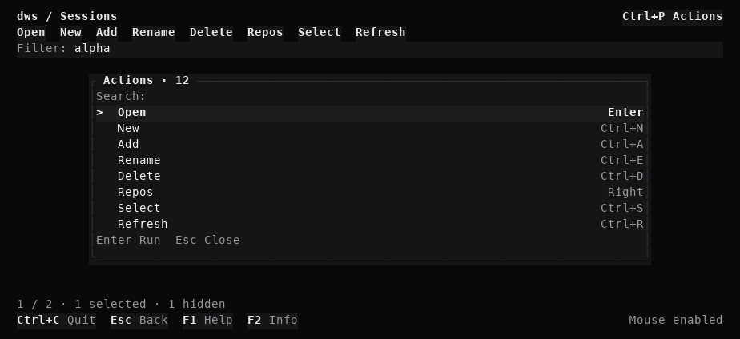
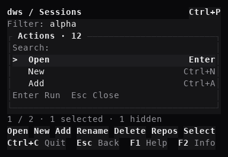
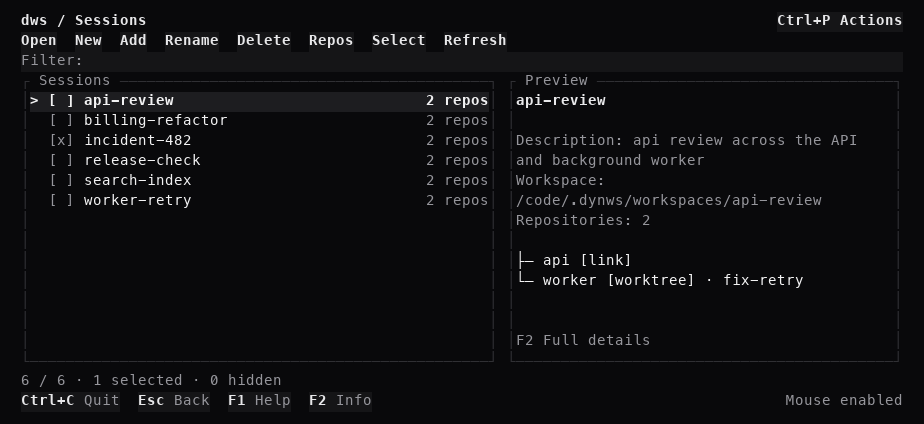

# OpenCode-inspired action discovery

Date: 2026-10-21. See [reference notes](../research/opencode-tui.md) for the
primary sources, local-reference limitation and decisions.

## Result

Ctrl+P opens a bounded searchable palette populated from the active screen's
existing shortcut definitions. The header trigger is clickable. Action labels
are quieter; the palette exposes shortcuts and commands hidden by compact
layout. Existing panes, folder-tree previews, keyboard controls, mouse selection,
NO_COLOR, metadata and mutation semantics remain in place. No runtime dependency
was added.

Search and focus belong to the palette, preserving the underlying session filter,
bulk selection and workflow input. Escape returns to the current step, Ctrl+C
quits globally, and keyboard/mouse execution closes the palette before calling
the existing handler. Delete opens the normal confirmation; the final confirm
operation is excluded from the searchable palette. As available commands change,
palette focus clamps to the new list. Small layouts retain scrolling and block
execution below the established minimum size.

## Verification

The suite now contains **90 unit, 18 CLI and 12 manifest tests: 120 total**.
Three palette tests exercise 120×40, 100×20, 80×24, 60×16 and 40×12; session-filter
and selection preservation; onboarding text; empty queries; stateful scrolling;
mouse execution; changing action sets; below-minimum cancellation; and exclusion
of final confirmation from action search.

The full PTY acceptance suite includes Ctrl+P filtering/cancellation alongside
real mouse events, workflow creation/addition, branch fetching/cancellation,
resizing, folder-tree details, editor restoration and actual Bash/Zsh completion.
Captures below come from actual TestBackend color/modifier cells, rather than
browser approximations. Tests and terminal checks use disposable fixtures.

## Skill installation

The `awwwards` skill is project-local at `.agents/skills/awwwards`, pinned to
upstream commit `ea8f1455c2b0e71469d4ecfd32f47862b834d2d0`. The upstream MIT license
and installation source are retained. Its website tooling was not executed, and
its web-framework requirements were not imposed on the Rust TUI.

## Separate measurements

Physical line counts, relative to the working snapshot before this pass:

| Category | Before | After | Change |
| --- | ---: | ---: | ---: |
| TUI implementation | 3,294 | 3,507 | +213 |
| Inline TUI tests | 1,469 | 1,600 | +131 |
| Runtime dependencies | 10 | 10 | 0 |

The installed binary matches the isolated release build, SHA-256
`b96f9483d755a4909829387bac1e6d6bce0f44b3c54bd010dc76ddd783565d4d`.
No real project sessions, repositories or worktrees were changed by verification.

Final verification completed 2026-10-22: macOS stable and Rust 1.88.0 passed
formatting, strict Clippy, all 120 locked tests and release builds. The native
package verified. Linux ARM64 stable and Rust 1.88.0 passed formatting, strict
Clippy, all 120 locked tests, full PTY acceptance and release builds. Linux source
hashes match the working source. Full terminal acceptance also passed against the
installed macOS binary. Remote CI was not run.
