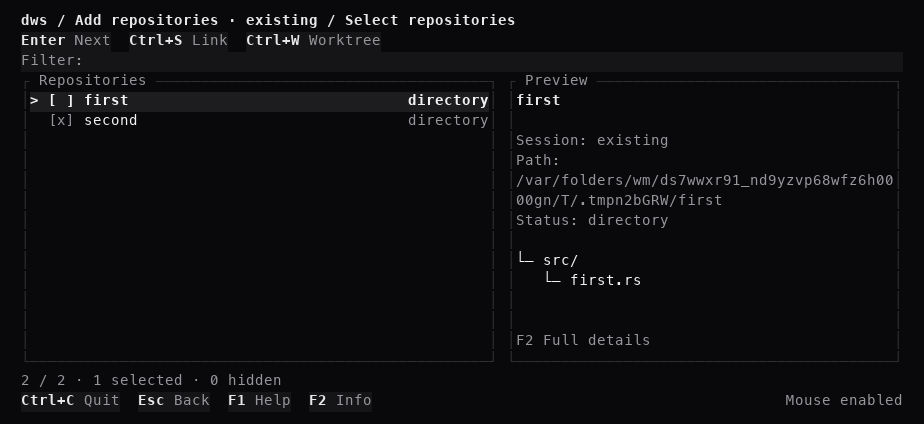

# Active-folder preview verification

Date: 2026-10-21. New/Add previews now show a cached, truncated tree of the
highlighted repository's folder. This is independent of checked selections.
Branch selection previews the repository whose branch is being chosen. The name
step retains the existing selected-repositories summary.

A single background worker per workflow reads directory entries. It never reads
file contents, runs Git, follows nested symlinks, or joins on the UI thread.
The event loop polls pending results, keeping idle previews and already-open F2
panels current. Rendering, filtering and resizing use cached results. The cache
expires when the New/Add workflow ends.

Bounds: two levels, at most 64 tree lines, at most 129 sampled entries per
directory. Sampled directories sort before files, then by name. Depth and size
omissions have explicit `…` markers. `.git`, `.dynws`, `node_modules`, `target`
and `.venv` stay collapsed. Loading, empty and unreadable folders have visible
states. F2 shows the same bounded tree on terminals without a side preview.

The test fixture highlights `first` while `second` is checked, proving the tree
follows focus. Removing `first` after caching and drawing at 120×40, 100×20,
60×16 and 40×12 verifies rendering does not rescan the filesystem. Unit tests
also cover ordering, symlink cycles, omitted build directories, depth/node
limits, empty/unreadable folders, asynchronous loading and F2 updates.

The real PTY suite opens New at 40×12, focuses a folder using the mouse, opens
F2, scrolls to a fixture filename after asynchronous loading, closes the overlay
and completes creation. Existing mouse, keyboard, resizing, worktree, editor
restoration and live Bash/Zsh completion checks remain included.

The complete suite is **87 unit + 18 CLI + 12 manifest = 117 tests**. No runtime
dependencies, CLI commands, metadata formats or mutation behavior changed.

## Separate measurements

Compared with the working snapshot before folder previews (physical lines,
including comments and blanks):

| Category | Before | After | Change |
| --- | ---: | ---: | ---: |
| TUI implementation | 3,112 | 3,294 | +182 |
| Inline TUI tests | 1,374 | 1,469 | +95 |
| Runtime dependencies | 10 | 10 | 0 |

The installed binary matches the isolated release build, SHA-256
`9457ef8f2559e5072d9448fbe6182a8fb3b25a553b3518c65668ade1d56d5605`.
The full PTY suite passed against that installed binary. Real project repositories,
sessions and worktrees were not changed by the checks.

Final checks: formatting and strict Clippy passed; macOS stable and Rust 1.88.0
passed all 117 locked tests and release builds. The native package verified.
Linux ARM64 stable and Rust 1.88.0 passed strict Clippy, all 117 locked tests,
the full PTY suite and release builds in the disposable fixture. Native PTY
checks passed for both the isolated debug executable and the installed release.
The Linux source and PTY-script hashes match the working tree. Clean target
directories avoid stale executables left by prior package verification.
No remote CI was run.
