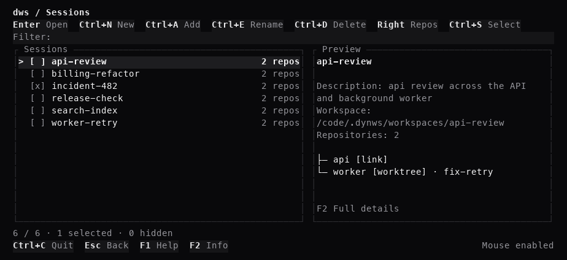
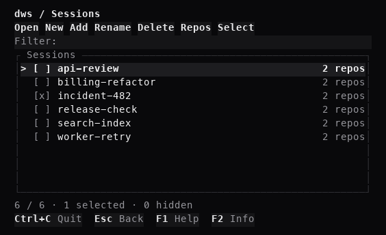
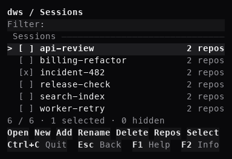

# Paneled interface and mouse verification

Date: 2026-10-21. This change applies the approved Paneled preview to the existing
Ratatui interface. The prior CLI, manifest, metadata and migration work remains
unchanged. No remote CI or publication is implied.

## Behavior

- Left-click focuses a list row; its independent `[ ]` / `[x]` / `[w]` marker
  toggles normal selection. The Worktree action remains explicit.
- Double-click opens the highlighted session regardless of bulk selection, or
  chooses a branch in the branch picker. Repository-list focus stays in its parent
  session. Releases, drags and right-clicks do nothing.
- Mouse-wheel navigation applies to the current list or scrollable modal.
  Pointer focus does not shift the list underneath a second click. Double-click
  identity includes both the row index and rendered hit area.
- Action labels are clickable and share the existing key handlers. At smaller
  widths, shortcut annotations disappear before action names. All seven session
  actions fit at 40×12, with Quit/Back/Help/Info on a separate line.
- Overlays exclude underlying list/action hit targets. Confirmations retain
  cancellation as the default; rapid action clicks coalesce for 350 ms, including
  clicks across a confirmation transition. Cancellation and confirmation still
  use the existing mutation locks, stale-state checks and deletion protections.
- Mouse capture belongs to the terminal guard and is disabled during cleanup,
  including setup failure and before editor launch.

## Reviewed presentation

The shared slate palette now has framed panes where space permits, tree details,
independent selection markers and compact action surfaces. At 40×12 the lighter
section divider preserves room for names and navigation. NO_COLOR retains
terminal-default colors and reverse focus. Rendering reads cached metadata only.

These are actual TestBackend render buffers, with color/modifier cells rendered
into images. PTY checks independently exercise terminal input and teardown.

The [confirmation capture](tui-mouse/confirmation.png) shows exact consequences
and the emphasized default cancellation control. Render tests also cover expanded
repositories, branch selection, naming, duplicate handling, loading, help,
empty/error states and long errors. Existing breakpoint tests cover 39/40/41,
59/60/61, 99/100/101 and 120 columns, against 11/12, 15/16, 19/20, 24 and 40 rows.

## Validation

The complete suite has **85 unit, 18 CLI and 12 manifest tests: 115 total**,
including 29 TUI tests. Four new mouse regression tests cover scrolled offsets,
resize invalidation, stable row positions, independent selection, double-click
opening, every session action at all supported sizes, ignored pointer events,
modal click-through/repeat protection, cancellation and confirmed deletion,
branch acceptance and overlay dismissal.

The expanded PTY suite sends actual SGR mouse input. It verifies checkbox
selection, deletion cancellation, repository navigation, F2/close clicks,
double-click session launch, compact creation and terminal-editor restoration.
Mouse-capture enable/disable sequences are checked before editor launch. Existing
keyboard, resize, fetch cancellation, creation, rollback and live Bash/Zsh Tab
completion checks remain included. Tests use disposable fixtures only.

A cached advisory audit (`cargo audit --no-fetch --no-yanked`) exits 0 with the
existing allowed `lru 0.18.1` warning, RUSTSEC-2026-0253. It does not refresh the
advisory database or check yanked versions. Cargo.toml and Cargo.lock are unchanged
by this pass.

## Separate measurements

Physical line counts, compared with the working snapshot before mouse support:

| Category | Before | After | Change |
| --- | ---: | ---: | ---: |
| TUI implementation | 2,761 | 3,112 | +351 |
| Inline TUI tests/fixtures | 1,155 | 1,374 | +219 |
| PTY acceptance script | 358 | 418 | +60 |
| Runtime dependencies | 10 | 10 | 0 |

The increase implements terminal mouse capture, geometry-based hit testing,
shared action dispatch and safety tests. It replaces the former section/shell
rendering rather than adding another theme or navigation mode.

## Final matrix and installed binary

| Environment | Toolchain | Result |
| --- | --- | --- |
| macOS ARM64 | Stable | Formatting, strict Clippy, 115 locked tests, full PTY suite, release and verified package passed |
| macOS ARM64 | Rust 1.88.0 | Formatting, strict Clippy, 115 locked tests, release and verified package passed |
| Linux ARM64 / disposable Podman fixture | Rust 1.88.0 | Formatting, strict Clippy, 115 locked tests, full PTY suite, release and verified package passed |
| Linux ARM64 / disposable Podman fixture | Stable | Formatting, strict Clippy, 115 locked tests, full PTY suite, release and verified package passed |

The Linux fixture's TUI and PTY script hashes match the final working source.
Remote GitHub Actions has not been run. A first simultaneous local package check
hit a shared extraction-directory race; serialized package verification passed.

The installed ARM64 binary at `~/.cargo/bin/dws` was replaced through
`cargo install --path . --locked --offline --force`. Its SHA-256 matches the
release binary: `23396ac95208c14c8469f87e7d901fa19da22aaa04f66a5350a765ca5322c24c`.
The previous installed binary is retained at `/private/tmp/dws-before-mouse-install`.
The complete PTY acceptance suite also passed against that installed binary,
including actual mouse input, terminal restoration and live shell completion.
Real project sessions and repository/worktree contents were not mutated by testing.
