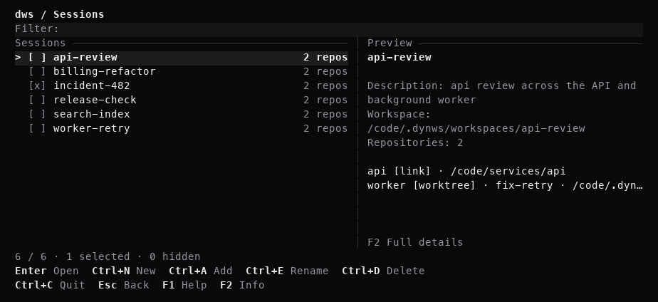
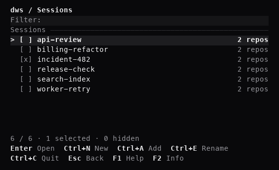
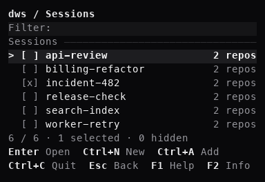

# Responsive TUI verification

Date: 2026-10-21. This report covers the presentation refinement after the CLI
cleanup, using the complete working tree including manifest creation. No remote
CI, commit, or publication is implied.

## Result

The interface now has shared slate styling, a labeled input surface, aligned
rows, independent focus/selection markers, separate counts and feedback, and
focused-item previews at 100×20 or larger. Medium and compact layouts retain
navigation, selections and workflow progress. Dialogs clear the content plane,
size to their content within the available space, and emphasize cancellation.
Long input and text use grapheme-aware display widths. The Add workflow identifies
the target session. Preview data and F2 details come from one cached detail model.

During fetching the source list remains navigable and filterable. Selection and
publication keys are guarded while the fetch is pending. Busy feedback is drawn
before discovery, fetching, publication, rename and deletion work. Rendering and
resizing perform no Git work, discovery, or filesystem checks.

## Reviewed captures

These images render the actual Ratatui TestBackend buffers, including their color
and modifier cells. They are not native terminal screenshots. Real PTYs separately
verify input, live resizing, shell completion, cancellation and terminal teardown.
They use synthetic session/repository data and require no special icon font.

Wide layout, 100×20:



Medium layout, 60×16:



Compact layout, 40×12:



The [Add workflow](tui-polish/add.png) and
[content-sized confirmation](tui-polish/confirmation.png) are also retained.
Review also covered expanded repositories, branch selection, naming, duplicate
handling, fetching, rename, empty/error states, help and complete details. Tests
capture those states through `DWS_CAPTURE_DIR` without updating snapshots:

```sh
env -u NO_COLOR DWS_CAPTURE_DIR=/tmp/dws-captures cargo test --bin dws tui::tests --locked
```

## Acceptance checks

The current suite has **81 unit, 18 CLI and 12 manifest integration tests: 111 total**,
including 25 TUI tests. Existing CLI commands, metadata formats, ownership checks,
locking, rollback and editor restoration remain covered.

New checks exercise widths 39/40/41, 59/60/61, 80, 99/100/101 and 120 against
heights 11/12, 15/16, 19/20, 24 and 40. They verify focused-item visibility with
120 sessions, preserved state across breakpoints, complete essential controls,
independent error/count rows, Unicode clipping, visible input tails/carets,
preview overflow routes, repository-focused details and guarded repeated deletes.
Existing checks exercise all four list types with 100 items and hidden selections.

The PTY script resizes through wide, medium, compact, below-minimum and short-wide
layouts with filtering and bulk selection active. A delayed Git wrapper proves
that source-list filtering still works during fetch, without changing the pending
selection. It then completes branch selection and worktree creation. Bash/Zsh
Tab completion and restored canonical/echo settings for a terminal editor pass.
The PTY suite runs with NO_COLOR; colored render captures independently verify the
default slate palette. Theme tests verify the terminal-default fallback.

Final matrix results are recorded below and in [GATES.tui-polish.md](../../GATES.tui-polish.md).

| Environment | Rust | Checks |
| --- | --- | --- |
| macOS ARM64 | Installed stable 1.97.0 | Formatting, strict Clippy, 111 locked tests, PTY acceptance, release, verified package |
| macOS ARM64 | 1.88.0 | Formatting, strict Clippy, 111 locked tests, release, verified package |
| Debian Bookworm ARM64 / Podman | 1.88.0 | Formatting, strict Clippy, 111 locked tests, PTY acceptance, release, verified package |
| Debian Bookworm ARM64 / Podman | Stable 1.99.1 | Formatting, strict Clippy, 111 locked tests, PTY acceptance, release, verified package |

Linux uses a disposable source fixture, locked vendored dependencies and the
existing official Rust validation image. Source hashes are compared with the
working tree before accepting results. The configured GitHub Actions matrix
remains separate evidence: remote CI has not been run.

A refreshed `cargo audit` exits 0 and retains the existing allowed `lru 0.18.1`
unsoundness warning, [RUSTSEC-2026-0253](https://rustsec.org/advisories/RUSTSEC-2026-0253).
The dependency lockfile and runtime dependencies are unchanged by this refinement.

## Separate measurements

Physical line counts include comments and blank lines. Split `src/tui.rs` at its
trailing `#[cfg(test)]` / `mod tests` boundary to distinguish implementation from
inline tests. The comparison uses the working snapshot immediately before this
presentation pass, rather than the older repository HEAD containing neither the
CLI cleanup nor manifest implementation.

| Category | Before | After | Change |
| --- | ---: | ---: | ---: |
| TUI implementation section | 2,184 | 2,761 | +577 |
| Inline TUI tests/fixtures | 802 | 1,155 | +353 |
| Python PTY acceptance script | 333 | 358 | +25 |
| Direct runtime dependencies | 10 | 10 | 0 |

The implementation increase provides responsive layout, styled rows, Unicode-safe
input, shared preview/details and bounded dialogs. Superseded plain rendering is
replaced rather than retained as a parallel theme or UI mode. The safety and
workflow implementation remains shared.
